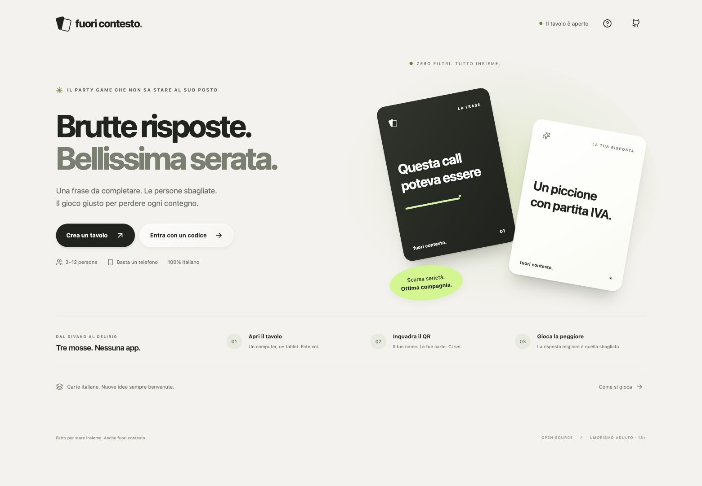

# Fuori Contesto

**Brutte risposte. Bellissima serata.** Un party game italiano per 3–12 persone: apri un tavolo sul computer, fai inquadrare il QR e ognuno gioca dal proprio telefono. Nessuna app e nessun account.



- Tavolo condiviso e mani private, sincronizzati in tempo reale.
- Nome scelto all'ingresso e modificabile durante la partita.
- Giudice a rotazione, risposte anonime, carte multiple ordinate e classifica.
- Punteggio obiettivo configurabile, nuova partita, rimozione giocatori e salto round.
- SQLite conserva partita, carte e sessioni dopo un riavvio.
- Mazzo originale italiano da **210 carte** e importatore opzionale dell'archivio storico italiano di CAH.
- Interfaccia responsive ispirata ai materiali Apple, navigazione da tastiera e riduzione del movimento.

Progetto indipendente, non affiliato a Cards Against Humanity o Apple. Umorismo adulto, 18+.

## Parti in due minuti

Serve **Node.js 24** (vedi `.nvmrc`).

```sh
git clone https://github.com/K4pp8/fuori-contesto.git
cd fuori-contesto
npm ci
npm run build
npm start
```

Apri **http://localhost:3000**, scegli **Crea un tavolo** e inquadra il QR dai telefoni connessi allo **stesso Wi-Fi**. Il computer mostra il tavolo e non occupa un posto giocatore. Chi lo gestisce può entrare dal telefono per giocare.

Il QR usa automaticamente un indirizzo LAN del server. Se hai più schede di rete o una VPN, scegli l'indirizzo corretto nelle impostazioni del tavolo, oppure crea `.env`:

```dotenv
PORT=3000
HOST=0.0.0.0
PUBLIC_URL=http://192.168.1.42:3000
DATABASE_PATH=./data/fuori-contesto.sqlite
```

Sostituisci l'IP con quello del tuo computer. Su macOS consenti a Node le connessioni in ingresso. Le reti guest possono impedire ai dispositivi di comunicare. `localhost` sul telefono indica il telefono stesso, non il computer.

## Sviluppo

```sh
npm ci
npm run dev
```

Un solo processo sulla porta 3000 serve Express, Socket.IO e Vite con hot reload. Per caricare `.env` anche in sviluppo: `node --env-file-if-exists=.env --import tsx server/index.ts` (senza watch).

```sh
npm run check       # TypeScript, test del motore/rete, validazione mazzi
npm run build       # frontend + backend compilati
npm audit           # vulnerabilità note
```

Lo stack è **TypeScript, Node.js, Express, Socket.IO, SQLite nativo (`node:sqlite`), React e Vite**. Nessun servizio cloud necessario. Su Node 24 SQLite può ancora emettere un avviso sperimentale.

## Carte italiane

Il mazzo di casa, `decks/core-it.json`, ha 50 frasi e 160 risposte originali sotto CC0. È stato preparato con assistenza AI e può essere migliorato attraverso pull request: il tono e la qualità comica richiedono cura editoriale umana.

L'archivio [ilario/Cards-Against-Humanity-ITA](https://github.com/ilario/Cards-Against-Humanity-ITA) è una fonte storica verificata, **non un catalogo aggiornato** (revisione utilizzata: 3 gennaio 2022). Contiene 90 frasi e 458 risposte. È opzionale e **non commerciale**:

```sh
npm run decks:import -- --accept-noncommercial
npm run decks:validate
# Riavvia il server; il mazzo compare nel selettore.
```

Il file importato è ignorato da Git. Non viene scaricato all'installazione e non cambia durante una partita. Fonte, attribuzione e licenza restano nel mazzo. Vedi [formato, licenze e aggiornamenti](docs/decks.md).

## Docker e hosting futuro

```sh
docker compose up --build -d
```

Apri la porta 3000 nella rete locale. Il volume `game-data` conserva SQLite. Con Docker imposta `PUBLIC_URL` all'indirizzo del **computer host**, perché l'IP del container non è raggiungibile dai telefoni. `compose.yaml` legge `PUBLIC_URL` da `.env`.

Per pubblicarlo in futuro: una singola istanza Node, volume persistente e reverse proxy HTTPS con supporto WebSocket. Non è un sito statico da GitHub Pages. La prima versione è progettata per gruppi fidati su LAN, non per un servizio pubblico multi-tenant. Vedi [architettura e limiti](docs/architecture.md).

## Repository e agenti

- [AGENTS.md](AGENTS.md): convenzioni, comandi e invarianti del progetto.
- `.agents/skills/game-engine/`: modifiche a regole, autorizzazione e stato realtime.
- `.agents/skills/italian-decks/`: contenuti, schema, provenienza e importazione.
- `.agents/skills/glass-ui/`: UI responsive, accessibilità e controlli visivi.
- CI GitHub Actions, Dependabot, template issue e pull request, guida contributi e policy sicurezza.

Le skill sono istruzioni locali per gli agenti che lavorano sul repository: non richiedono API AI e non aggiungono AI alle partite. La configurazione segue la [documentazione ufficiale sulle skill](https://learn.chatgpt.com/docs/build-skills).

## Privacy e limiti

Nessuna analytics, nessun font remoto. Il browser conserva un token locale per rientrare; il server conserva solo l'hash del token. Nomi, mani e stato del gioco restano nel database locale. Le stanze scadono dopo 24 ore dall'ultima azione e sono rimosse durante la pulizia periodica. SQLite e i suoi backup possono conservare tracce dei dati eliminati: non è una cancellazione forense.

Non cancellare i dati del browser durante la partita: perderesti il token di rientro. Chi possiede il codice stanza può vedere il tavolo pubblico, ma non le mani. L'ingresso è consentito nella lobby; un giocatore disconnesso conserva il posto. Se non torna, chi gestisce il tavolo può rimuoverlo o saltare il round. Su HTTP locale il traffico non è cifrato; usa HTTPS fuori da una LAN fidata.

## Contribuire e licenze

Leggi [CONTRIBUTING.md](CONTRIBUTING.md), [CODE_OF_CONDUCT.md](CODE_OF_CONDUCT.md) e [SECURITY.md](SECURITY.md).

**Codice: MIT. Mazzo originale: CC0-1.0.** Il mazzo storico opzionale resta **CC BY-NC-SA 2.0 Italia**, con limitazione non commerciale e obblighi di attribuzione/condivisione allo stesso modo. Non viene rilasciato sotto MIT. Dettagli in [THIRD_PARTY_NOTICES.md](THIRD_PARTY_NOTICES.md).
